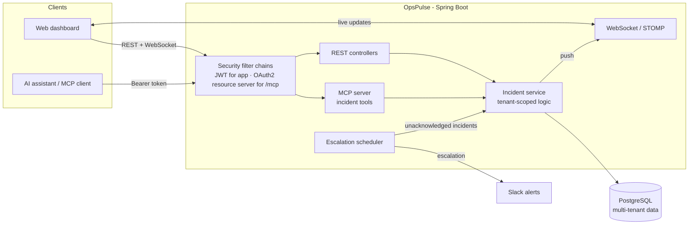

# OpsPulse

A multi-tenant, real-time operational **incident command center** — built as a backend-focused learning and portfolio project with Spring Boot and Java 21.

Multiple organizations (tenants) track operational incidents in one platform, with strict per-tenant data isolation, live updates, automatic escalation of unacknowledged incidents, Slack alerting, and an AI-accessible interface via a secured MCP server.

> Status: active development. Single-instance; see the Roadmap for the path to horizontal scale.

## Architecture



## Features

- **Multi-tenancy with strict isolation** — every query is scoped to the tenant from the validated token; one tenant can never read or mutate another's data (enforced in the service layer and **proven by integration tests**).
- **Real-time updates** — incident changes are pushed to connected clients over WebSocket/STOMP.
- **Automatic escalation** — a scheduled job promotes incidents that go unacknowledged, with configurable levels.
- **Slack alerting** — escalations fire alerts to a Slack channel via webhook.
- **AI integration (MCP)** — a Model Context Protocol server exposes read and write incident tools to AI clients, secured so the tenant always comes from the token, never from a tool parameter.
- **Security** — JWT authentication for the app; an OAuth2 resource server protecting the `/mcp` endpoint.

## Tech stack & why

| Choice | Why |
|--------|-----|
| **Java 21** | Modern LTS; records, pattern matching, and virtual-thread-ready for a concurrent, I/O-heavy backend. |
| **Spring Boot** | Mature, batteries-included backend framework — security, data, scheduling, and WebSocket support in one ecosystem, which let me focus on the domain rather than wiring. |
| **PostgreSQL** | A battle-tested relational database; incidents, tenants, and users are highly relational with strong consistency needs, so a RDBMS fit better than a document store. |
| **Spring Data JPA / Hibernate** | Cuts boilerplate for persistence while leaving room to drop to custom queries where tenant-scoping matters. |
| **WebSocket + STOMP** | An incident board must reflect changes instantly; polling would be wasteful, so a push protocol was the right call. |
| **Spring Security (JWT + OAuth2 resource server)** | Stateless auth suits a multi-tenant API; the resource server pattern lets the same login tokens protect the AI/MCP surface without a second identity system. |
| **Spring AI (MCP server)** | Exposes the platform to AI assistants through a standard protocol instead of a bespoke integration. |
| **Scheduled escalation (Spring `@Scheduled`)** | Escalation is time-based and in-process for now — deliberately the simplest thing that works before reaching for a message queue. |
| **Docker** | Runs PostgreSQL locally in a reproducible way, matching the deployment target. |
| **JUnit 5 + H2** | Fast integration tests for the tenant-isolation security boundary. (H2 in PostgreSQL-compatibility mode; moving to Testcontainers for true Postgres parity is on the roadmap.) |
| **Maven** | Standard, well-supported build and dependency management for the Spring ecosystem. |

## Security model: tenant isolation

The core invariant: **the tenant identity always comes from the cryptographically validated token — never from a request body or tool parameter the caller controls.** Write operations carry only content (title, status, incident id); the service loads and mutates records scoped by the token's tenant, rejecting any attempt to reach across tenants. This boundary is covered by integration tests that assert tenant A cannot read, update, or acknowledge tenant B's incidents.

## Getting started

Prerequisites: JDK 21, Docker, Maven.

```bash
# 1. Start PostgreSQL
docker run --name opspulse-db -e POSTGRES_PASSWORD=yourpassword -e POSTGRES_DB=opspulse -p 5432:5432 -d postgres:16

# 2. Configure src/main/resources/application.properties
#    (gitignored — set datasource, jwt.secret, and alert.webhook.url yourself)

# 3. Run the app (starts on port 9090)
./mvnw spring-boot:run
```

<!-- TODO: add an application.properties.example with placeholder values -->
<!-- TODO: note how to open the frontend (opspulse-index.html) -->

## Testing

```bash
./mvnw test
```

Runs the multi-tenant isolation integration tests (JUnit 5, H2 in-memory).

## Roadmap

- Deploy to AWS (live demo)
- Observability — Spring Boot Actuator health checks, structured logging, Micrometer metrics
- CI/CD — GitHub Actions (build + test on every push)
- Flyway migrations (replace `ddl-auto` for real schema management)
- Secrets externalization + HTTPS + short-lived tokens (hardening)
- Redis — distributed scheduler lock, WebSocket relay across instances, caching
- Kafka — event-driven alerting
- Full OAuth2 authorization server (discovery, PKCE) for the MCP surface

## Author

**Abdullah Abdul Qudoos** — [portfolio](https://abdullahabdulqudoos.vercel.app/)
<!-- TODO: add GitHub repo link -->
https://github.com/Abdullahkk659/opspulse